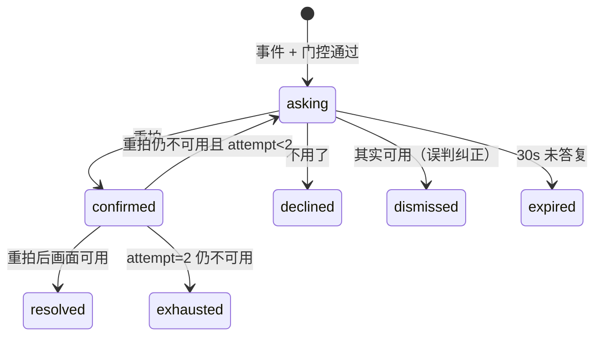

# ESP32-S3 IMU 数据采集系统

基于 ESP32-S3-EYE 开发板的 IMU（加速度计）数据采集与实时展示系统。

## 系统架构

```
┌─────────────────┐      WiFi/HTTP      ┌──────────────────┐
│   ESP32-S3-EYE  │  ───────────────→   │   Flask 服务器    │
│                 │   JSON 数据上传      │                  │
│  • QMA7981 IMU  │                     │  • 数据接收 API   │
│  • WiFi 上传    │                     │  • SQLite 存储    │
│  • 串口调试     │                     │  • Web 实时展示   │
└─────────────────┘                     └──────────────────┘
```

## 功能特性

### ESP32 端
- ✅ QMA7981 加速度计 I2C 读取
- ✅ WiFi 连接与自动重连
- ✅ HTTP POST 上传 IMU 数据
- ✅ 串口实时输出（调试用）
- ✅ 批量上传优化（减少网络请求）
- ✅ OV2640 摄像头环境图像按需采集（JPEG 抓取；暗光/遮挡帧仍上传）
- ✅ 图像采集任务状态机（pending → sent → received → captured / failed）
- ✅ IMU I2C 总线与摄像头 SCCB 时分复用，采集后自动恢复 IMU 采样
- ✅ 主动询问的实体答复通道（第 9 周）：询问下发、LED 双闪、短按=重拍 / 长按=不用了
- ✅ 多来源独立状态与数据年龄（第 10 周）：IMU / 摄像头 / 链路 / GNSS 缺失分开显示
- ✅ 观测时间与接收时间分离：补传旧数据按原观测时间解释，不覆盖最新数据
- ✅ 陈旧、失败、未尝试、缺失、时效未知五类状态与用户提示对照
- ✅ GNSS 未配置明确标缺失，不生成任何坐标；失败/离线不写成设备故障

### 服务端
- ✅ Flask REST API 接收数据
- ✅ SQLite 数据库持久化存储
- ✅ Web 前端实时数据展示
- ✅ 历史数据图表（Chart.js）
- ✅ 数据统计与采样率计算
- ✅ 环境图像按需采集 API（下发任务 / 上传 JPEG / 状态查询）
- ✅ 图像采集失败记录（遮挡 blocked / 错误 error）与保留策略（保留最近 30 张，纠错样本永不清理）
- ✅ 自然语言助手支持「环境取图」意图
- ✅ 视觉推理结果结构化反馈：标签 / 模型分数 / 模型版本 / 判定依据 / 不确定说明（第 8 周）
- ✅ 低分 / 画面不可用（暗、模糊、遮挡）→ 拒识，明确“还不能确定”及原因（第 8 周）
- ✅ 人工纠错入口：模型原结果快照留存；纠错后锁定推理，保证结果—反馈对应（第 8 周）
- ✅ 样例对照：正常 / 低分 / 未知 / 错误 / 误判（高分误判高亮）（第 8 周）
- ✅ 画面不可用 → 主动询问「是否重拍」：事件触发、确认/忽略/误判纠正、冷却与单飞行（第 9 周）
- ✅ 重拍复用原有图像任务流，结果回填原询问；达重拍上限转求助建议（第 9 周）
- ✅ 多源证据交互上下文：原始观测 / 派生状态 / 交互决策三层，事实带来源、更新时间与规则版本（第 11 周）
- ✅ 上下文回答 + 至多一条追问；遮挡不判危险、无 GNSS 不造坐标、模型推断与观测分开（第 11 周）
- ✅ 冲突样例落库与回放：`/api/context/traces?only_conflict=1`（第 11 周）
- ✅ 用户纠错落成显式提醒偏好：F1–F5 有限反馈规则，本轮 / 该类原因 / 这条事件三种作用域（第 12 周）
- ✅ “这次不用提醒”只压本轮、到期自动恢复默认；偏好可查看、可单条清除，清除即回到第 9 周默认策略（第 12 周）
- ✅ 重复提醒次数可取证：`reminder_events` 记录观测/提醒/抑制计数，修改前后 4 次打扰 → 0 次（第 12 周）
- ✅ 配置版本 append-only：参数变更与回退都生成新版本，历史保留且旧版本仍可解释（第 12 周）

## 硬件要求

- **开发板**：ESP32-S3-EYE
- **IMU 传感器**：QMA7981（I2C 接口）
- **接线**：
  - SDA → GPIO4
  - SCL → GPIO5
  - VCC → 3.3V
  - GND → GND

## 软件要求

### ESP32 端
- ESP-IDF v5.4.4 或更高版本
- Python 3.8+（ESP-IDF 依赖）

### 服务端
- Python 3.8+
- Flask 3.0+
- Flask-CORS 4.0+

## 快速开始

### 1. 克隆仓库

```bash
git clone https://github.com/yourusername/esp32-imu.git
cd esp32-imu
```

### 2. ESP32 固件编译与烧录

```bash
# 设置 ESP-IDF 环境
. $IDF_PATH/export.sh  # Linux/Mac
# 或
.\export.ps1           # Windows PowerShell

# 设置目标芯片
idf.py set-target esp32s3

# 配置 WiFi（编辑 main/wifi_manager.h）
# 修改 WIFI_SSID 和 WIFI_PASS

# 配置服务器地址（编辑 main/http_uploader.h）
# 修改 SERVER_URL

# 编译
idf.py build

# 烧录（替换 COMx 为实际串口）
idf.py -p COM5 flash monitor
```

### 3. 启动服务端

```bash
cd server

# 安装依赖
pip install -r requirements.txt

# 第 8 周：下载视觉推理模型（约 14MB，也可改用模型课推理服务，见下）
python vision/models/fetch_model.py

# 启动服务器
python app.py
```

访问 http://localhost:5000 查看实时数据。

> **第 8 周模型后端切换**（教师基线与学生候选模型同一接口）：
> - `MODEL_BACKEND=auto`：学生候选就绪则用学生，否则用教师基线（HTTP 优先，本地 ONNX 兜底）
> - `MODEL_BACKEND=teacher`：强制教师基线；`MODEL_BACKEND=student`：学生候选，未就绪时回退教师基线
> - 模型分数是**未经校准的模型输出分数**，界面只表述为"模型分数"，不写成现实正确率
> - 教师 HTTP 契约：`POST image/jpeg`，返回 `model_version` 和 `topk`（或 `label/score`）；分数必须在 0–1，标签和模型版本不能为空

## 项目结构

```
esp32-imu/
├── main/                      # ESP32 固件源码
│   ├── main.c                 # 主程序
│   ├── qma7981.h              # QMA7981 驱动头文件
│   ├── qma7981.c              # QMA7981 驱动实现
│   ├── wifi_manager.h         # WiFi 管理器头文件
│   ├── wifi_manager.c         # WiFi 管理器实现
│   ├── http_uploader.h        # HTTP 上传器头文件（含服务器地址）
│   ├── http_uploader.c        # HTTP 上传器实现
│   ├── command_handler.c      # 命令轮询与任务路由（含图像任务）
│   ├── image_capture.h        # OV2640 拍照模块头文件
│   ├── image_capture.c        # OV2640 拍照模块实现
│   ├── inquiry_handler.h      # 第 9 周：主动询问的设备侧（答复与状态）
│   ├── inquiry_handler.c      # 第 9 周：询问接收、按键答复、超时清理
│   ├── http_client_util.h     # 第 9 周：从 command_handler 原样提取的 HTTP 工具
│   ├── http_client_util.c     # GET 文本 / POST JSON（command_handler 与询问共用）
│   ├── sampling_state.h       # 第 10 周：最近一次采样尝试/boot_id（只记录状态）
│   ├── sampling_state.c       # 第 10 周：线程安全的采样状态实现
│   └── idf_component.yml      # ESP-IDF 组件依赖（esp32-camera）
├── server/                    # 服务端代码
│   ├── app.py                 # Flask 应用主程序
│   ├── inquiry.py             # 第 9 周：主动询问的门控/状态机/冷却与 API（第 12 周加 G6 偏好门）
│   ├── requirements.txt       # Python 依赖
│   ├── test_week6.py          # 第 6 周功能自动化测试
│   ├── test_week7.py          # 第 7 周功能自动化测试
│   ├── test_week8.py          # 第 8 周功能自动化测试
│   ├── test_week9.py          # 第 9 周功能自动化测试（含原始记录导出）
│   ├── week9_evidence.json    # 第 9 周完整任务测试原始记录（提交物）
│   ├── source_state.py        # 第 10 周：来源状态/年龄/对照聚合（纯读）
│   ├── test_week10.py         # 第 10 周时间处理与来源缺失测试
│   ├── week10_evidence.json   # 第 10 周测试原始记录（提交物）
│   ├── context_engine.py      # 第 11 周：三层证据、R1–R9、回答/追问（纯读，第 12 周加 R10）
│   ├── test_week11.py         # 第 11 周上下文解释与冲突/缺失测试
│   ├── week11_evidence.json   # 第 11 周测试原始记录（提交物）
│   ├── reminder_pref.py       # 第 12 周：显式提醒偏好、事件计数、配置版本与回退
│   ├── test_week12.py         # 第 12 周偏好作用域/重复提醒前后对照测试
│   ├── week12_evidence.json   # 第 12 周测试原始记录（提交物）
│   ├── images/                # 采集到的环境图像（运行时生成）
│   ├── vision/                # 视觉推理模块（第 8 周）
│   │   ├── models.py          # 统一推理接口/教师基线/学生接入位/拒识逻辑
│   │   └── models/            # 模型文件与测试夹具
│   │       ├── fetch_model.py # 模型下载脚本（onnx 不入库）
│   │       └── fixtures/      # 测试夹具
│   │           ├── manifest.json  # 夹具来源与 SHA-256
│   │           └── *.jpg      # 真实 JPEG 测试样本
│   └── templates/
│       └── index.html         # Web 前端页面
├── partitions.csv             # 8MB Flash 分区表（factory 3MB）
├── CMakeLists.txt             # ESP-IDF 项目配置
├── sdkconfig.defaults         # ESP-IDF 默认配置
├── .gitignore                 # Git 忽略文件
└── README.md                  # 项目说明
```

## API 文档

### 接收 IMU 数据

**POST** `/api/imu`

请求体：
```json
{
  "timestamp": 1234567890.123,
  "ax": 0.123,
  "ay": -0.456,
  "az": 9.780
}
```

响应：
```json
{
  "status": "success",
  "message": "数据接收成功",
  "timestamp": 1234567890.123
}
```

### 获取最新数据

**GET** `/api/imu/latest`

响应：
```json
{
  "timestamp": 1234567890.123,
  "ax": 0.123,
  "ay": -0.456,
  "az": 9.780,
  "created_at": "2024-01-01 12:00:00"
}
```

### 获取历史数据

**GET** `/api/imu/history?limit=100`

响应：
```json
{
  "data": [...],
  "count": 100
}
```

### 获取统计信息

**GET** `/api/stats`

响应：
```json
{
  "total_records": 12345,
  "latest_record": "2024-01-01 12:00:00"
}
```

### 环境图像按需采集（第 7 周）

前端点击「采集一张」后，服务端创建一条图像任务（状态 `pending`），ESP32 轮询到任务后拍照并回传 JPEG。相关接口：

**POST** `/api/image`
创建一条图像采集任务（默认 `source=device`）。
```json
{ "source": "device" }
```
响应：
```json
{ "request_id": "xxxx", "status": "pending", "source": "device" }
```

**GET** `/api/collect/pending`
ESP32 轮询待处理任务；图像任务会携带 `type=image`、`sensor=camera`。

**POST** `/api/image/<id>/received`
ESP32 取到任务后回报已接收（状态 `sent` → `received`）。

**POST** `/api/image/<id>/data`（raw JPEG body）
ESP32 上传 JPEG 图像，需携带 `X-Capture-Ts` 头（设备微秒时间戳）；服务端校验 JPEG 头 `\xff\xd8`。成功后状态置为 `captured`。

**POST** `/api/image/<id>/fail`
采集失败回报，body：`{ "reason": "blocked" | "error" }`。

**GET** `/api/image/<id>`
查询任务状态与元数据（status、captured_at、device_ts_us、size_bytes 等）。

**GET** `/api/image/<id>/file`
下载该任务对应的 JPEG 文件。

**GET** `/api/images`
列出全部图像任务（保留最近 30 张；已有人工纠错的图片永不清理）。

### 视觉推理与人工纠错（第 8 周）

采集成功后自动推理一次。所有结果按 `request_id` 与输入图像、人工反馈严格对应；分数只表述为“模型输出分数（未经校准）”，不写成现实正确率。

**POST** `/api/image/<id>/infer`

对已采集图像执行（重新）推理。已有人工纠错时返回 409（锁定推理结果，避免覆盖反馈对应的原结果）；模型不可用时返回 503（不伪造结果）。

**GET** `/api/image/<id>/result`

结构化结果：

- `image`：输入记录（原图 URL、采集时间、来源）；
- `inference`：`label`、`score`、`model_name`、`model_version`、`model_source`、`topk`、`usability`、`is_rejected`、`rejected_reason`、`uncertain_note`；
- `decision`：判定依据（top1/top2/分差/阈值/画面指标）；
- `bucket`：样例归类；
- `feedback`：人工纠错快照；
- `score_note`：分数语义提示。

**POST** `/api/image/<id>/feedback`

人工纠错：`{corrected_label, note}`。模型原结果以快照留存（original_label/original_score），不覆盖推理结果；提交后该任务的推理结果锁定。

**GET** `/api/samples/compare?limit_per_bucket=8`

样例对照（四类基础 + 误判叠加）：

| 桶 | 含义 |
|---|---|
| `normal` | 模型接受且无纠错；不代表真实正确率 |
| `low_score` | 模型拒识为低分或候选接近 |
| `unknown` | 画面不可用 / 模型不可用；拒识后被人工补充答案也在此桶 |
| `error` | 采集失败、超时或图像无法解码 |
| `misjudged` | 模型接受但被人工纠错；`is_high_score` 标记高分误判 |

响应同时返回 `bucket_notes`、`score_note` 和每桶数量，前端直接展示，避免口径分叉。

### 第 8 周验收与演示

**真实模型准备（二选一）**

```bash
# 本地 ONNX 教师基线兜底
python server/vision/models/fetch_model.py

# 或使用模型课教师 HTTP 服务
export MODEL_BACKEND=teacher
export TEACHER_MODEL_URL=http://<teacher-host>/infer
export TEACHER_MODEL_API_KEY=<optional>
```

**严格测试（模型不可用即失败）**

```bash
cd server
REQUIRE_REAL_MODEL=1 WEEK8_EVIDENCE=week8_evidence.json python test_week8.py
```

**5 分钟演示顺序**

1. 正常画面：展示标签、模型分数（小数，未校准）、模型版本和原图；
2. 遮住镜头：展示黑图 + “画面过暗/疑似遮挡” + 重采建议，证明失败画面仍有输入；
3. 低分图：展示“还不能确定”、top1/top2/分差和拒识阈值；
4. 人工纠错：展示“模型原判 → 人工修正”，再点对照样例，原图/结果/反馈三者同屏；
5. 样例对照：正常、低分、未知、错误、误判五列，高分误判高亮。

**证据口径**

- `source=device` 的真机采集 + 真实模型结果，计入端到端证据；
- `source=replay` 的真实 JPEG + 真实模型，计入自动化回归，但不替代真机证据；
- 静态标签、mock 结果只用于 UI 测试，不写入推理结果表，不计入验收；
- 不计算、不宣称模型准确率；`normal` 只表示“未被人工否定”；
- 场景粗分类是规则后处理，不用于精确位置、危险程度或人身安全判断。

### 画面不可用的主动询问（第 9 周）

本周问题：画面无法使用时，系统能否主动询问「是否重拍」，并尊重用户选择？

**事件来源（三源归一）**

| 来源 | 触发点 | `trigger` |
|---|---|---|
| 设备 | `POST /api/image/<id>/fail` 上报 `blocked` | `device` |
| 服务端 | 推理后 `usability` 为 `dark` / `blur` / `blocked` | `server` |
| 模型 | 推理 `status` 为 `unavailable` / `decode_failed` | `model` |

低分（`low_score`）与候选接近（`ambiguous`）属于"模型不确定"，不是"画面无法使用"，**不触发**询问。

**状态机**



**门控与冷却（默认值，环境变量可覆盖）**

| 参数 | 默认 | 说明 |
|---|---|---|
| `INQUIRY_TIMEOUT_S` | 30 | 未答复自动按忽略处理，不重投、不重弹 |
| `INQUIRY_GLOBAL_GAP_S` | 60 | 任意两条询问之间的最小间隔 |
| `DECLINE_COOLDOWN_S` | 600 | 拒绝后同原因冷却（"拒绝后不反复打扰"的硬指标） |
| `EXPIRE_COOLDOWN_S` | 300 | 超时后同原因冷却 |
| `DISMISS_COOLDOWN_S` | 1800 | 判定"其实可用"后同原因冷却 |
| `MAX_RETAKE` | 2 | 单张图重拍次数上限，超限转 `exhausted` 并建议走求助 |
| `INQUIRY_ALLOW_REPLAY` | 0 | 回放来源是否参与（默认 0：回放只做演示/回归） |

单飞行：同一时刻只允许一条未决询问；同一 `request_id` 只问一次；重拍产生的新任务归属原询问，不再新开一条。

**反馈优先级**：求助回应（第 3 周，P0）> 主动询问（第 9 周，P1）> 普通状态提示（P2）。设备端 LED 由求助通道优先占用，求助空闲时才用双闪提示询问。

**接口**

| 端点 | 说明 |
|---|---|
| `GET /api/inquiry/pending` | 网页轮询当前未决询问（含剩余秒数与冷却参数） |
| `POST /api/inquiry/<id>/answer` | `{"decision": "retake"\|"decline"\|"usable", "channel": "ui"\|"voice"\|"device_key", "mute": false}` |
| `GET /api/inquiry/<id>` | 单条询问详情 |
| `GET /api/inquiries?limit=20` | 最近询问列表（验收取证用） |
| `GET /api/collect/pending` | 设备通道：新增 `type=inquiry`，复用既有轮询，设备 HTTP 次数不变 |

答复语义：

- `retake`：复用第 7 周图像任务流新建一次采集（`new_image_task`），结果回填原询问；
- `decline`：登记冷却，同原因不再追问（`mute=true` 时长更长）；
- `usable`：只记录误判纠正，不重拍，**不写**第 8 周人工纠错表（避免口径混用）。

重复答复返回 409：只认第一个有效答复，后续答复仅在日志留痕，不重复提示。

**三通道协同**：网页卡片（视觉）＋ 浏览器 TTS 播报与语音答复（语音）＋ 板载按键 / LED（实体）。实体：短按 = 重拍，长按 ≥800ms = 不用了；无询问时按键行为与第 3 周完全一致。

**第 9 周验收与演示**

```bash
cd server
venv\Scripts\python.exe test_week9.py    # 16 项；失败即非零退出
# 原始记录写入 server/week9_evidence.json
```

演示顺序（约 5 分钟）：

1. 正常采集：IMU 曲线照常，说明底层采集链路未被改动；
2. 遮住镜头取图：网页出现"画面被遮挡，要重拍一张吗？"，同时 LED 双闪、语音播报；
3. 点"重拍一张"：生成新的图像任务，设备真实取图，重拍结果回填原询问；
4. 点"不用了"（或长按按键）：10 分钟内同类情况不再询问，连续遮挡不再打扰；
5. 点"其实可用"：记录误判纠正，不重拍；
6. 说明运行位置：模型跑在服务端（本地 ONNX 或教师 HTTP），设备端只做采集与按键，服务在本机 `:5000`。

**证据口径**

- `source=device` 的真机采集计入端到端证据；
- `replay` 仅用于演示与自动化回归，默认不触发询问；
- `test_week9.py` 中"模型不可用"用例为故障注入，证据里标注 `injected`；
- 冷却参数在测试中被压到秒级，证据 `summary.config` 会如实记录，生产默认值见 `server/inquiry.py`。

### 区分传感器观测与当前状态（第 10 周）

本周问题：定位、运动和网络信息不是同时到达，怎样避免把旧数据当成当前状态？

本项目没有 GNSS，**不补造位置**；真实来源是 IMU、摄像头快照和网络链路。课程中的
“旧位置 + 本次 no_fix”用“旧图 + 本次 blocked”做同构案例，“网络在线但位置未更新”
用“链路在线 + IMU 陈旧”做真实案例。

**来源与阈值**

| source | 页面 | 性质 | 默认 TTL | 缺失/离线时 |
|---|---|---|---|---|
| `imu` | 加速度计 | 连续流 | `IMU_STALE_MS=5000` | 只标陈旧，不判故障 |
| `camera` | 环境图像 | 快照 | `CAMERA_STALE_MS=600000` | 失败保留旧图 |
| `link` | 网络链路 | 链路状态 | `LINK_OFFLINE_MS=10000` | 离线只表示无法确认 |
| `gnss` | 定位 | 未配置 | — | 固定 `absent`，不返回坐标 |

**三段时间与年龄**

```text
设备观测：observed_uptime_ms（qma7981_read_accel 返回后）
设备发送：send_uptime_ms（HTTP 发出前）
服务器接收：received_at（epoch 秒）

transit_ms  = send_uptime_ms - observed_uptime_ms
observed_at = received_at - transit_ms / 1000
age_ms      = now - observed_at
```

- 补传 120 秒前的样本时，滞留时间会进入 `transit_ms`，年龄仍是 120 秒；
- `/api/imu/latest` 按 `COALESCE(observed_at, received_at)` 取最新，补传旧行不会顶掉新行；
- 旧固件没有新字段时 `observed_at=NULL`、状态为 `unknown_age`，**不猜测** `timestamp` 的单位；
- 跨重启或 `transit_ms` 非法/超过 1 小时时同样标 `unknown_age`，不给出“新鲜”结论。

**状态语义**

| status | 含义 | 页面提示 |
|---|---|---|
| `not_attempted` | 从未尝试/从未收到 | 无法判断；没有数据不等于故障 |
| `in_progress` | 图像任务进行中 | 正在采集，请稍候 |
| `ok` | 最近成功且未超过 TTL | IMU 可作当前值；图像仍是快照；链路仅代表可达 |
| `stale` | 超过 TTL、设备离线或上传停滞 | 已 X 秒未更新，不能当作当前状态 |
| `failed` | 有明确失败证据（读失败/blocked/error/no_fix） | 本次失败；下面显示上次有效值，不代表现在 |
| `unknown_age` | 缺少可比较的观测时间 | 时效未知，不能当作当前状态 |
| `absent` | 来源未配置/硬件缺失 | 未配置此来源，不是设备故障 |

硬规则：

1. **静默不等于失败**：设备离线只标 `stale`，不写“设备故障”；
2. **失败不覆盖旧观测**：`failed` 只更新尝试状态，`imu_data` 旧行和旧 JPEG 原样保留；
3. **链路在线不等于数据新鲜**：`link.status=ok` 与 `imu.status=stale` 可以同时成立；
4. **图像是快照**：`camera.ok` 只表示最近一次取图成功，不代表当前画面。

**接口**

`GET /api/sources`：

```json
{
  "server_time": 1763000000.123,
  "ttl": {"imu_ms": 5000, "camera_ms": 600000, "link_ms": 10000},
  "sources": [
    {
      "source": "imu",
      "status": "stale",
      "status_reason": "upload_stalled",
      "status_label": "陈旧",
      "user_message": "设备仍在采样，但服务器已 12.3s 未收到新数据；不能当作当前状态。",
      "can_represent_current": false,
      "age_ms": 12300,
      "age_basis": "device_transit",
      "observed_at": 1762999987.0,
      "received_at": 1762999987.02,
      "transit_ms": 21,
      "last_attempt": {"result": "ok"},
      "last_success": {"age_ms": 12300},
      "raw": {"ax": 0.12, "ay": -0.03, "az": 9.79},
      "raw_ref": "imu_data:66846",
      "provenance": "device"
    }
  ],
  "comparisons": {
    "old_but_failed": {"available": true, "message": "..."},
    "link_ok_data_stale": {"available": true, "message": "..."}
  }
}
```

`/api/imu/latest` 新增 `observed_at / received_at / age_ms / age_basis / freshness /
is_stale / derived / derived_note`；陀螺仪与姿态仍保留兼容字段，但明确标注“由加速度估算”。

设备端心跳复用原有 2 秒轮询：

```text
GET /api/collect/pending?device_id=esp32-s3-eye&imu=ok|fail|busy&err=read&fails=N
```

不新增 HTTP 请求；`device_status` 只记录最近心跳与尝试结果。

**前端**

页面顶部新增“来源状态与数据年龄”区：

- 四张卡分别显示状态、年龄、观测/接收时刻、传输时延、本次尝试、原始值；
- 年龄每秒按服务端 `server_time` 递增，避免浏览器时钟偏差；
- IMU 非 `ok` 时，六轴数值上方出现“最近一次有效观测，不是当前状态”横幅；
- 下方自动展示两个对照：旧数据 + 本次失败、链路在线 + 数据未更新。

**验收与演示**

```bash
cd server
venv\Scripts\python.exe test_week10.py     # 16 项；失败即非零退出
# 原始记录写入 server/week10_evidence.json
```

演示顺序（约 5 分钟）：

1. 正常采样：IMU 卡 `ok`，年龄 <1s，`provenance=device`；
2. 遮挡镜头取图：本次 `blocked`，旧图仍在，出现“旧图 + 本次失败”对照；
3. 拔掉/遮挡 IMU：轮询上报 `fail`，IMU 卡 `failed`，旧值带年龄保留；
4. 断开设备：10s 后链路和 IMU 变 `stale`，不显示“设备故障”；
5. 补传一条 2 分钟前的样本：`/api/imu/latest` 不被覆盖，历史中该样本年龄为 2 分钟；
6. 说明 GNSS 卡固定为“缺失”，系统没有任何经纬度字段。

**证据口径**

- `source=device` 的真实设备数据计入端到端证据；
- `test_week10.py` 使用固定 `now` 注入与临时库，不替代真机复验；
- 不计算、不宣称位置精度；GNSS 缺失与摄像头 blocked 都不写成设备故障；
- TTL 只影响“能否当当前状态”，不删除历史观测。

### 根据多源证据组织交互上下文（第 11 周）

本周问题：系统知道“最近一次画面”和“当前是否移动”后，应该回答什么、还应询问什么？

本项目没有 GNSS，**不补造位置**。“最近报告的位置”用“最近一次环境快照 + 单项模型标签”
做同构案例，并且只描述那张图，不写成当前位置；真实来源仍是 IMU、摄像头快照、网络链路
和模型结果。定位融合算法与情感/危险推断不进入本周任务。

**三层数据**

| 层 | 内容 | 例子 |
|---|---|---|
| 原始观测 | 带来源、观测/接收时间、数据年龄、原始引用（`raw_ref`） | `imu_data:66851`、上次成功取图 |
| 派生状态 | 由有限规则与有效时间窗计算，不直接测量 | 5s 窗口 → 静止 / 有活动 / 无法判断 |
| 交互决策 | 回答、待确认、冲突、是否追问 | `D2 回答 + 追问是否重拍` |

**规则（`week11-rules@1.0.0`；第 12 周新增 R10 后升为 `week12-rules@1.1.0`，R1–R9 未改）**

| 规则 | 内容 | 关键参数 |
|---|---|---|
| R1 时效门 | 超过 TTL 只能报年龄并标注“不是当前” | 复用第 10 周 TTL |
| R2 运动派生 | ≥4 个样本，按轴标准差判活动；合矢量偏差只作标定提示 | 窗口 5s；静止 ≤0.2 / 活动 ≥0.4 m/s² |
| R3 位置缺失 | GNSS 固定缺失，不返回坐标，不从标签反推位置 | — |
| R4 危险禁令 | 遮挡/过暗只表示画面不可用，`hazard` 恒为空 | — |
| R5 推断标注 | 模型结果标 `inference`，带版本/分数/未经校准说明 | 拒识即“未能确认” |
| R6 跨源时序 | 快照与运动窗口对比，判断“画面可能已变化” | 快照复核 120s |
| R7 冲突显式化 | 链路在线+IMU 陈旧、遮挡+旧图、旧图+模型标签 | — |
| R8 追问相关 | 至多一条追问，且与问题主题一致 | 运动补采样 / 位置做澄清 / 画面补取图 |
| R9 只读与来源 | 不写原始观测；保留 device/replay 来源；trace 存规则版本 | — |

**决策**

| 决策 | 场景 | 回答 | 追问 |
|---|---|---|---|
| D1 | 事实新鲜且无冲突 | 直接回答 | 无 |
| D2 | 遮挡 / 快照过期或可能变化 | 只描述上次画面 | 要现在拍一张吗 |
| D3 | 运动样本不足或陈旧 | 无法判断当前是否移动 | 设备还在采样吗 |
| D4 | 问位置/坐标 | 无定位来源，不回答坐标 | 你是指最近一次画面吗 |
| D5 | 全部来源缺失 | 不能回答 | 查看来源 / 重新采集 |

**接口**

`POST /api/context`：

```json
{ "question": "我现在在动吗？" }
```

响应包含 `trace_id / rule_version / rules / thresholds / topic / decision / answer /
facts / pending / followup / conflicts / layers / motion / snapshot / hazard / location`。
`facts` 每条都有 `kind`（observation/derived/inference/absence）、`rule_id`、`source`、
`observed_at`、`age_ms`、`can_represent_current`、`provenance`。

取证接口：

| 端点 | 说明 |
|---|---|
| `GET /api/context/traces?limit=20&only_conflict=1` | 最近解释；只取冲突样例 |
| `GET /api/context/traces/<trace_id>` | 单条回放（规则版本/事实/冲突） |

`context_traces` 为第 11 周新增表，只加不改；原始 `imu_data / image_records /
inference_results` 不被写入。

**前端**

来源状态下新增“上下文解释与追问”：预设问题、自由输入、结论、已知事实（观测/派生/推断/
缺失打标）、待确认、追问快捷按钮、三层对照表、规则版本与 trace id。
自然语言助手只加窄白名单（“我在动吗 / 我现在在哪 / 现在安全吗 / 你现在知道什么”），
`看看周围环境`、`查看上次数据`、`重新采集一次` 行为不变。

**验收与演示**

```bash
cd server
venv\Scripts\python.exe test_week11.py    # 20 项；失败即非零退出
# 原始记录写入 server/week11_evidence.json
```

演示顺序（约 5 分钟）：

1. 设备静止，问“我在动吗” → “静止”，展示 5s 窗口与样本数；
2. 拿起晃动再问 → “有活动”，说明这是派生状态；
3. 断开设备 10s 后问 → “无法判断当前是否移动”，展示年龄与追问；
4. 遮住镜头取图，问“环境安全吗” → “无法确认 + 不判危险”，展示重拍追问；
5. 问“我现在在哪” → 明确无定位来源、无坐标，旧快照只作参考；
6. 打开三层对照与 `/api/context/traces?only_conflict=1`，出示冲突样例。

**证据口径**

- `test_week11.py` 使用固定 `now` 注入与临时库，不替代真机复验；
- 真机数据 `provenance=device` 计入端到端证据；`replay` 只用于回归；
- 不计算、不宣称位置精度；不输出坐标或危险结论；模型分数只表示模型输出；
- trace 保留规则版本与阈值快照，阈值调整必须升版本，旧记录仍可解释。

### 让用户纠错影响后续提醒（第 12 周）

本周问题：用户说“这次不用提醒”，系统怎样记住当前选择，又能恢复默认？

做法是把用户的每一次纠错落成**可查看、可撤销、会到期的显式偏好**，而不是不可见的权重。
第 9 周的记录级冷却保持原样，它就是“默认策略”；本周的偏好叠加在默认策略之上，
**清除偏好 = 回到默认策略（仍会提醒），而不是“完全没有冷却”**。

**有限反馈规则 F1–F5（`inquiry.py` + `reminder_pref.py`）**

| 规则 | 用户说的话/动作 | 确定的去向 | 生效范围 |
|---|---|---|---|
| F1 confirm 确认 | “好，重拍一张” | 走第 9 周重拍链路，并自动撤销该事件的“稍后” | 无新增偏好 |
| F2 correct 纠正 | “其实可用”（系统误判） | 该类原因暂时静音 | `event_reason`，默认 30 分钟 |
| F3 ignore 忽略 | “这次不用提醒” | 本轮静音，本轮结束自动恢复默认 | `session`，不超过本轮 |
| F4 snooze 稍后 | “待会儿再问” | 压住这条事件到点为止，到期后同类事件仍可提醒 | `event_key`，默认 300s |
| F5 restore_default | “恢复默认提醒” | 撤销全部偏好 + 参数回到默认快照 | 全局 |

“这次不用提醒”**只写本轮**，不会静默升级成永久关闭：所有静音偏好都必须带到期时间，
词表到作用域的映射是确定的（`match_scope_text`），自由文本不会被解释成“永久别问”。

**偏好作用域（越小越贴合字面意思）**

| 作用域 | 键 | 典型来源 | 默认到期 |
|---|---|---|---|
| `session` 本轮 | `SESSION_ID` | F3 忽略 | 本轮结束（进程一轮 + 15 分钟 TTL 取先） |
| `event_reason` 该类原因 | `blocked`/`dark`/… | F2 纠正、“这类都别问了” | `reason_mute_s` 86400s / `correct_mute_s` 1800s |
| `event_key` 这条事件 | 图 request_id + reason 的稳定签名 | F4 稍后 | `snooze_s` 300s |
| `request_id` 这张图 | 单次取图 request_id | 前端显式选择 | 跟随上述动作 |

“本轮”= **服务端进程一次启动为一轮**（`sess-xxxxxxxx` 进程级唯一），同时受
`PREF_SESSION_TTL_S`（默认 900s）约束；重启服务或 TTL 到期都会结束本轮，
`session` 级偏好随之失效并记为 `session_expired` —— 这就是自动恢复默认。

**门控与规则（相对第 9/11 周只加不改）**

| 编号 | 位置 | 内容 |
|---|---|---|
| G6 偏好门 | `inquiry.on_unusable`，在 G4 之后、G5 之前 | 询问创建前先问一次“用户是否已说过别问”；命中即不弹窗，事件仍计数并留 `suppress_code` |
| G1–G5 | 第 9 周原样 | 原因集合 / 真机来源 / 单飞行 / 间隔冷却 / 同 request_id 不重复 |
| R10 偏好一致 | `context_engine.build_context` | 显式偏好压掉 R8 的“拍一张”追问，并在回答里如实说明原因与恢复入口；只压 `capture`，采样/澄清/来源类追问不受影响 |

`reminder_events` 记录每个事件的 `seen_count / trigger_count / suppress_count`，
这是“修改前后重复提醒次数”这组对比的唯一数据来源；`inquiries` 只加三个可空列
（`event_key / session_id / config_version`），不改任何既有列语义。

**数据表（只新增，不动 `imu_data / image_records / inference_results / human_feedbacks`）**

| 表 | 用途 |
|---|---|
| `reminder_preferences` | 一条偏好一行；撤销只标记 `revoked_at`，历史保留 |
| `reminder_events` | 事件签名与观测/提醒/抑制计数 |
| `reminder_feedbacks` | 每次纠错/清除/回退的流水（配置变化记录） |
| `config_versions` | append-only 配置快照；回退也是新增版本，历史永不删除 |

**接口**

| 端点 | 说明 |
|---|---|
| `GET /api/preferences` | 生效偏好 + 本轮剩余 + 参数 + 配置版本 + 反馈流水 + 统计 |
| `POST /api/preferences` | 显式设置一条偏好（`scope/key/action/reason/duration_s/channel`） |
| `POST /api/preferences/<pref_id>/revoke` | 清除单条偏好（回到默认策略） |
| `POST /api/preferences/session/clear` | 清除本轮全部偏好 |
| `POST /api/preferences/restore_default` | F5 恢复默认（撤销偏好 + 参数回默认快照） |
| `GET /api/config/versions?limit=20` | 配置版本历史（来源/参数快照/说明） |
| `POST /api/config/rollback` | 回退到某版本 = 重新生效并追加新版本 |
| `POST /api/config/params` | 参数变更（未知键 400，变更即新版本） |
| `GET /api/reminders/stats?limit=50` | 事件计数与按原因/按码的抑制分布 |

答复入口沿用第 9 周：`POST /api/inquiry/<inq_id>/answer` 可带 `feedback` / `scope`，
不带即为第 9 周原语义。语音/文字里说“恢复默认提醒”会由 `POST /api/nl_query`
前置路由到 `intent="reminder_preference"`。

**修改前后对照（`server/week12_evidence.json`）**

同类“画面被遮挡”事件各 4 次，第 9 周冷却参数压到 0，因此打扰次数的变化只可能来自本周偏好：

| 阶段 | 观测次数 | 实际打扰 | 被压掉 | 说明 |
|---|---|---|---|---|
| 修改前（默认策略） | +4 | **+4** | +0 | 每次都弹提醒 —— 这就是重复打扰 |
| 修改后（记一条 F3 本轮静音） | +4 | **0** | +4 | 全部被 G6 压掉，`suppress_code=session_muted` |

同一事件重放（同一 `request_id` + 同一原因）只让 `seen_count` 变 2，`trigger_count`
仍为 1，抑制码 `already_asked`；清除本轮偏好后下一条事件立刻重新触发询问。

**前端**

新增“🔕 提醒偏好与配置版本”面板：本轮剩余时间与本轮口径说明、生效偏好列表（单条撤销）、
参数与配置版本、配置版本历史（可回退）、事件计数表与前后对照、恢复默认按钮。
询问卡片增加作用域下拉（由服务端 `config.scopes` 驱动）：默认“仅本次”＝不写任何偏好，
与第 9 周行为逐字节一致；其余选项各对应一种显式作用域。

**验收与演示**

```bash
cd server
venv\Scripts\python.exe test_week12.py    # 20 项；失败即非零退出
# 原始记录写入 server/week12_evidence.json
venv\Scripts\python.exe test_week9.py     # 回归 16 项
venv\Scripts\python.exe test_week11.py    # 回归 20 项
```

演示顺序（约 5 分钟）：

1. 遮住镜头连续造成 4 次同类事件 → 打扰 4 次，出示 `before` 计数；
2. 第 5 次弹提醒时选“这次不用提醒” → 面板出现 1 条本轮偏好，到期时间＝本轮结束；
3. 再造成 4 次同类事件 → 打扰 0 次、压掉 4 次，出示 `after` 计数；
4. 单条撤销 → 下一条事件立刻又弹提醒（回到默认策略，不是永久关闭）；
5. 文字说“这类都别问了” → 该类原因静音，事件被 `reason_muted` 压掉；
6. 点“恢复默认提醒” → 偏好清空、参数回默认快照、版本 +1，提醒立刻恢复；
7. 打开配置版本历史，回退到 v1 → 生成新版本而历史不减；
8. 问“环境安全吗” → 本轮静音时追问消失并说明原因，恢复默认后追问回来。

**证据口径**

- `test_week12.py` 用临时库、固定参数环境变量，不写生产 `imu_data.db`；
- 偏好与配置操作只允许写本周 4 张表，`human_feedbacks` 保持 0 条（保存反馈 ≠ 在线学习成功）；
- 打扰/抑制数字只来自 `reminder_events` 计数，前后对照的条件除“是否记录显式偏好”外完全相同；
- 配置版本 append-only，每条含来源、参数快照与说明，历史版本仍可解释当时的行为。

## 排错指南

### ESP32 无法读取 IMU

1. **检查接线**：确认 SDA=GPIO4, SCL=GPIO5
2. **检查上拉电阻**：I2C 总线需要 4.7kΩ 上拉至 3.3V
3. **检查芯片 ID**：串口输出应显示 `芯片 ID 校验通过: 0x90`
4. **降低 I2C 频率**：修改 `qma7981.h` 中的 `QMA7981_I2C_FREQ_HZ` 为 100000

### WiFi 连接失败

1. **检查 SSID 和密码**：确认 `wifi_manager.h` 中的配置正确
2. **检查路由器**：确认 2.4GHz 频段可用（ESP32 不支持 5GHz）
3. **查看串口日志**：会显示详细的连接状态和错误信息

### 服务器无法接收数据

1. **检查服务器地址**：确认 `http_uploader.h` 中的 `SERVER_URL` 正确
2. **检查防火墙**：确保服务器端口 5000 可访问
3. **测试 API**：使用 curl 或 Postman 测试 `/api/imu` 接口

### 画面不可用但没有出现询问

1. **是否在冷却期**：`GET /api/inquiries?limit=5` 看最近一条的 `cooldown_until`；拒绝过同类情况后 10 分钟内不会再问
2. **是否已有未决询问**：单飞行，已有一条 `asking` 时新事件不会新建
3. **原因是否可询问**：低分 / 候选接近不触发询问（属于模型不确定）
4. **来源是否为回放**：`INQUIRY_ALLOW_REPLAY=0`（默认）时回放图不触发
5. **是否被显式偏好压掉**：`GET /api/preferences` 看生效偏好与本轮剩余，`GET /api/reminders/stats` 的 `suppress_by_code` 会给出 `session_muted / reason_muted / event_muted / request_muted / event_snoozed`；说“恢复默认提醒”或 `POST /api/preferences/restore_default` 立即恢复

## 技术细节

### QMA7981 驱动

- **I2C 地址**：0x12
- **芯片 ID**：0x90（实际读取值，可能与数据手册不同）
- **数据格式**：14 位有符号数，左对齐
- **量程**：±2g / ±4g / ±8g / ±16g 可选
- **采样率**：128Hz（默认）

### 数据传输协议

- **协议**：HTTP POST
- **格式**：JSON
- **频率**：每 10 个样本上传一次（可配置）
- **时间戳**：观测时的开机微秒（`esp_timer_get_time()`，不是 Unix 时间）；第 10 周另带 `observed_uptime_ms` / `send_uptime_ms`，由服务端换算数据年龄

### 数据库设计

```sql
CREATE TABLE imu_data (
    id INTEGER PRIMARY KEY AUTOINCREMENT,
    timestamp REAL NOT NULL,      -- 观测时开机微秒（非 Unix 时间）
    ax REAL NOT NULL,             -- X 轴加速度
    ay REAL NOT NULL,             -- Y 轴加速度
    az REAL NOT NULL,             -- Z 轴加速度
    request_id TEXT,              -- 远程采集任务关联
    created_at TEXT DEFAULT CURRENT_TIMESTAMP,  -- 服务器接收时间（UTC 文本）
    observed_at REAL,             -- 第 10 周：观测时刻（epoch 秒，服务端换算）
    received_at REAL,             -- 第 10 周：接收时刻（epoch 秒）
    observed_uptime_ms INTEGER,   -- 第 10 周：设备观测开机毫秒
    send_uptime_ms INTEGER,       -- 第 10 周：设备发送前开机毫秒
    boot_id TEXT,                 -- 第 10 周：本次开机标识
    age_basis TEXT,               -- 第 10 周：device_transit / unknown
    provenance TEXT NOT NULL DEFAULT 'device'
);

CREATE TABLE device_status (
    device_id TEXT PRIMARY KEY,
    last_seen_at REAL,            -- 最近一次请求（2s 轮询/上传）
    boot_id TEXT,
    uptime_ms INTEGER,
    imu_attempt TEXT,             -- ok / fail / busy / unknown
    imu_error TEXT,               -- read / timeout / camera_busy ...
    imu_fail_count INTEGER DEFAULT 0,
    updated_at REAL
);
```

## 扩展方向

- [ ] 添加更多传感器（陀螺仪、磁力计、气压计）
- [ ] 实现数据融合算法（卡尔曼滤波、互补滤波）
- [ ] 添加机器学习模型（动作识别、异常检测）
- [ ] 支持 MQTT 协议
- [ ] 添加用户认证和权限管理
- [ ] 实现 OTA 固件更新
- [ ] 添加数据导出功能（CSV、JSON）
- [ ] 支持多设备同时连接

## 许可证

MIT License

## 贡献

欢迎提交 Issue 和 Pull Request！

## 联系方式

如有问题，请通过 GitHub Issues 联系。
